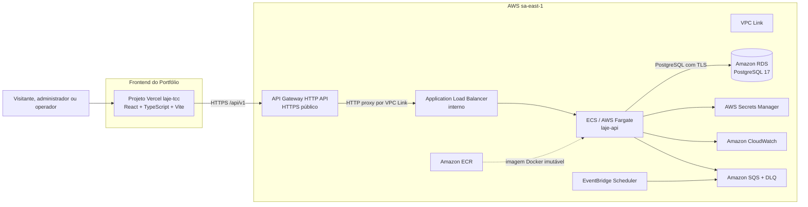

# Arquitetura do LAJE TCC

## Escopo e estado

Este documento descreve a arquitetura AWS do ambiente web `laje-tcc`, que compõe a entrega de Portfólio. O projeto Vercel `laje`, usado permanentemente na operação da liga, continua com Supabase e não é atendido por esta API. No TCC, o frontend React/Vite é publicado na Vercel; a `laje-api`, o único RDS PostgreSQL escolhido para a entrega e a infraestrutura de execução ficam na AWS, na região `sa-east-1`.

A Vercel é uma exceção aprovada especificamente para o frontend deste projeto. Os nomes dos recursos e variáveis Terraform mantêm o prefixo `staging`; a instância `laje-staging-postgres` é o único RDS selecionado para a entrega TCC, sem requisito de provisionar outro banco com nome `production`.

Consulta de somente leitura ao plano de controle AWS em 09/11/2026 mostrou o serviço ECS `laje-staging-api` com uma tarefa desejada e em execução, task definition `:36`, e o RDS `laje-staging-postgres` disponível. Esse retrato confirma o estado dos recursos naquela data; não confirma os health checks, a última execução do workflow nem a validação funcional antes de uma demonstração ou release.

O desenvolvimento local conectado pelo túnel SSM e a aplicação pública `laje-tcc` usam o mesmo RDS. A revisão do código encontrou testes de fluxo que exigem um banco denominado `laje_priority_flows` e criam registros e contas sintéticas determinísticas. Não foi confirmada a existência desse banco isolado na instância AWS, e os testes não removem automaticamente todos os registros inseridos. Não há evidência para afirmar que contas administrativas, por si só, isolem dados da demonstração.

## Diagrama de implantação



O endpoint público atual é `https://rkckaptyaf.execute-api.sa-east-1.amazonaws.com`; o frontend usa `https://rkckaptyaf.execute-api.sa-east-1.amazonaws.com/api/v1`. A rota `$default` da API Gateway está integrada por `HTTP_PROXY` e VPC Link ao listener do ALB interno.

## Componentes

| Camada                   | Responsabilidade                                              | Implementação atual                                                                          |
| ------------------------ | ------------------------------------------------------------- | -------------------------------------------------------------------------------------------- |
| Frontend                 | Interface pública e administrativa                            | Projeto Vercel `laje-tcc`, React 18, TypeScript e Vite                                       |
| API                      | Autenticação, autorização, contratos HTTP e regras de negócio | Node.js + Express em container no ECS/Fargate                                                |
| Entrada externa          | Endpoint HTTPS e roteamento privado para a VPC                | API Gateway HTTP API + VPC Link                                                              |
| Balanceamento interno    | Encaminhar as chamadas para as tasks da API                   | Application Load Balancer interno                                                            |
| Persistência             | Armazenar dados do sistema                                    | Amazon RDS for PostgreSQL 17, privado, TLS obrigatório; único RDS selecionado para a entrega |
| Imagens                  | Armazenar imagens versionadas da API                          | Amazon ECR com tags imutáveis e scan-on-push                                                 |
| Segredos                 | Entregar credenciais apenas ao backend                        | AWS Secrets Manager e IAM task roles                                                         |
| Logs e métricas          | Diagnóstico da aplicação e infraestrutura                     | CloudWatch; logs da API em `/laje/staging/api`                                               |
| Processamento assíncrono | Gerar prévias de chaveamento e tratar retries                 | Amazon SQS, DLQ, worker da API e EventBridge Scheduler                                       |
| CI/CD                    | Validar código e publicar a API                               | GitHub Actions, OIDC para AWS e Terraform                                                    |

## Rede e segurança

- API Gateway é o único endpoint público de entrada para a API.
- O VPC Link encaminha requisições ao ALB interno; o ALB não é exposto à Internet.
- As tasks Fargate usam subnets públicas e IP público de saída para acessar os serviços AWS sem NAT Gateway. O Security Group das tasks não aceita entrada direta da Internet; o tráfego da aplicação vem do ALB.
- O RDS permanece em subnets privadas, com `PubliclyAccessible=false`, TLS e ingress PostgreSQL restrito ao Security Group da API.
- A allowlist CORS do ambiente atual contém `https://laje-tcc.vercel.app`.
- Segredos do banco e da autenticação são referenciados no Secrets Manager e injetados apenas no runtime do backend. Valores secretos não devem ser registrados em arquivos, bundle do frontend ou logs.
- GitHub Actions assume uma role AWS por OIDC; não são usadas access keys AWS persistentes no repositório.

## Persistência e regras

A `laje-api` é a única camada de aplicação que acessa o RDS. O schema inicial está em `infra/database/baseline/schema.sql`; alterações posteriores são versionadas em `infra/database/migrations/`. A aplicação usa TLS no PostgreSQL e expõe health checks separados para aplicação e banco. O RDS consultado está como Single-AZ, criptografado, com backup automático de um dia e sem proteção contra exclusão habilitada. Capture snapshot manual identificado antes de mudanças destrutivas e valide a restauração em instância temporária privada antes de depender dela para recuperação.

As operações administrativas passam pela API, que autentica a sessão, valida permissões e regras do domínio antes de persistir dados. Classificação, chaveamento, jogos, calendário e auditoria são documentados por domínio nos módulos e contratos da API.

## Fluxos principais

### Consulta pública e operação administrativa

```text
Navegador -> Vercel laje-tcc -> API Gateway -> VPC Link -> ALB interno
          -> ECS/Fargate laje-api -> RDS PostgreSQL
```

As requisições autenticadas usam os contratos `/api/v1` da API. O frontend não recebe credenciais PostgreSQL nem se conecta diretamente ao banco.

### Processamento assíncrono

```text
laje-api -> registro do job no PostgreSQL -> SQS -> worker da API -> PostgreSQL
                                      EventBridge Scheduler -> SQS
```

A fila de prévias usa long polling, visibility timeout, retry e DLQ. O Scheduler aciona manutenção dos jobs por mensagens SQS. Os detalhes de execução estão em [workloads operacionais](./operational-workloads.md).

## CI/CD e observabilidade

O workflow `Deploy AWS` é manual (`workflow_dispatch`) e limitado à branch `main`. No caminho `deploy`, ele valida Terraform, publica ou reutiliza uma imagem ECR imutável, aplica as migrations operacionais no RDS escolhido para o TCC, mantém uma task Fargate e valida HTTPS, saúde da API, saúde do banco, CORS e smoke E2E.

O Terraform define o log group `/laje/staging/api`, seis alarmes para métricas do RDS, SQS e rotação de credenciais, health check do target group em `/api/v1/health` e configuração do runtime. Os alarmes não possuem ação SNS configurada, portanto não se promete notificação por e-mail. A validação ampliada de observabilidade está vinculada à [LAJE-40](https://joaoduartte.atlassian.net/browse/LAJE-40); evidências de cada publicação devem vir da execução correspondente do workflow.

## Uso local e publicado

O frontend público `laje-tcc` usa `https://rkckaptyaf.execute-api.sa-east-1.amazonaws.com/api/v1`. Para desenvolvimento, o frontend pode encaminhar chamadas via Vite e a API local pode acessar o mesmo RDS por túnel SSM. Os testes de fluxo em `tests/flows` exigem que `DATABASE_URL` contenha `laje_priority_flows`; criam contas sintéticas como `laje38-ci` e `laje150-ci` e registros com IDs fixos. Esses usuários não estão provisionados como contas de homologação. Como os testes deixam registros no banco e a existência de uma base AWS isolada com esse nome não foi confirmada, não execute esses testes contra a base de demonstração. Detalhes e limites estão no [runbook](./staging-aws.md#isolamento-dos-testes-no-rds-compartilhado).

O prefixo `staging` nos nomes AWS é parte da configuração existente e não cria uma exigência de banco separado para a publicação TCC. Antes da entrega, associe o commit do frontend, a imagem ECR, a execução do workflow, os health checks e a validação manual do fluxo à evidência da versão apresentada.

## Referências

- [Deploy da API AWS](./deployment.md)
- [Runbook AWS do TCC](./staging-aws.md)
- [Terraform AWS](../infra/aws/terraform/README.md)
- [Workloads operacionais](./operational-workloads.md)
